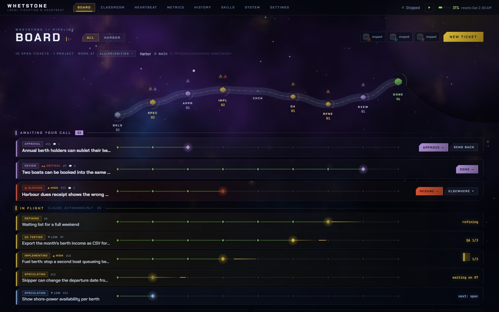
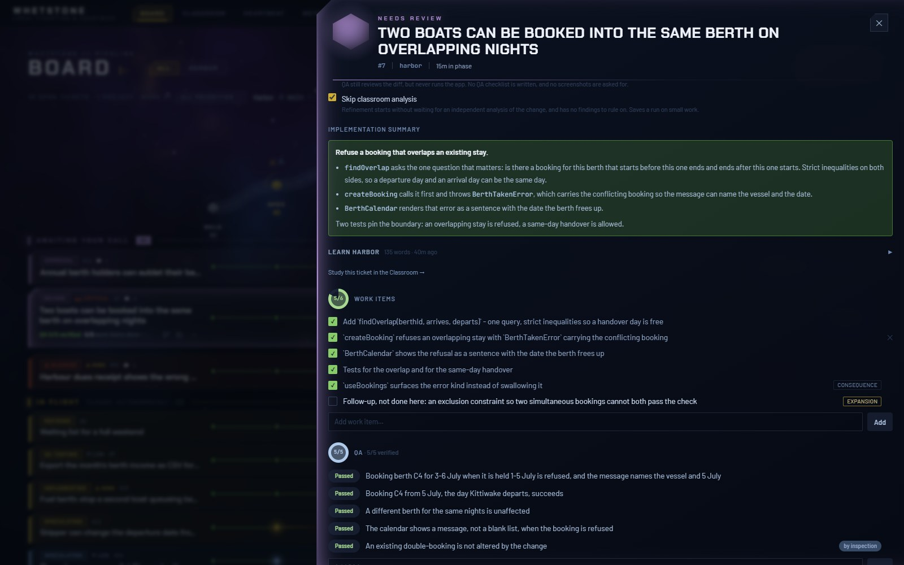
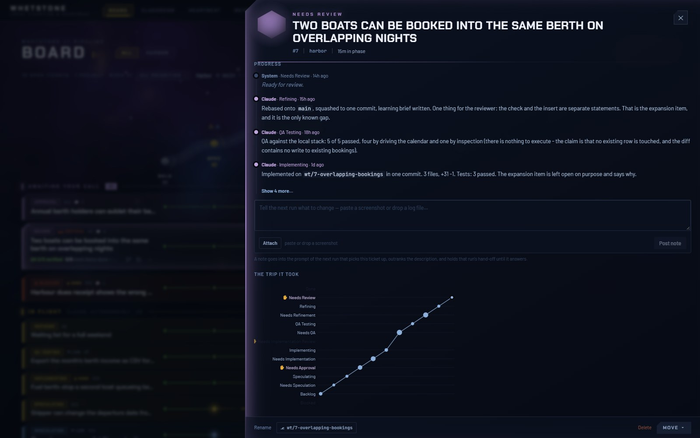
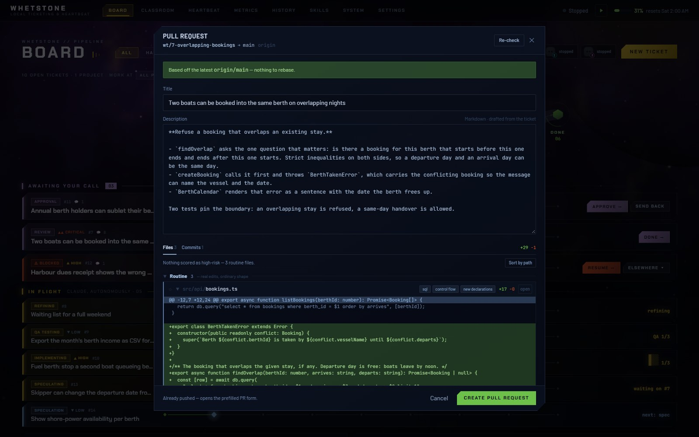
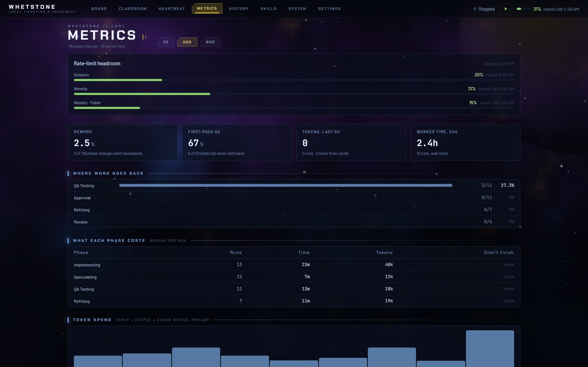
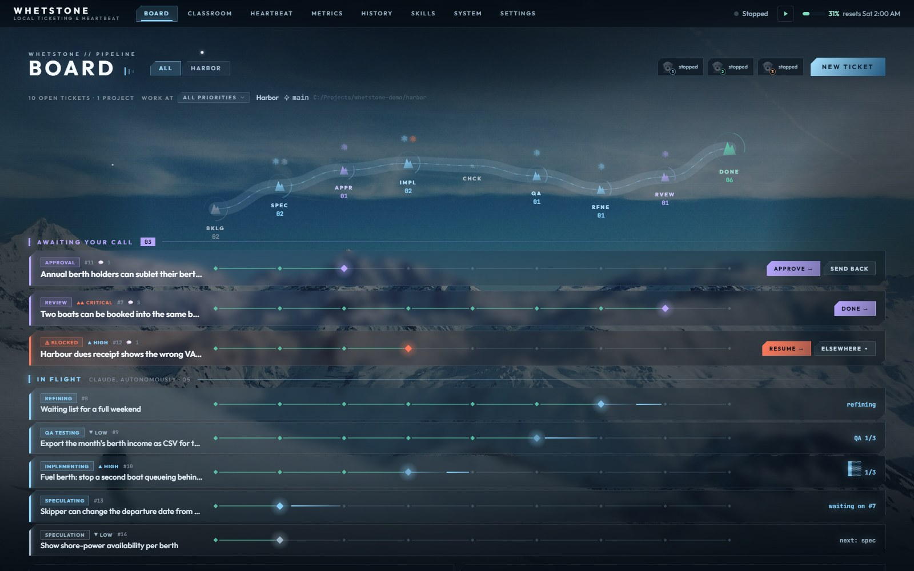
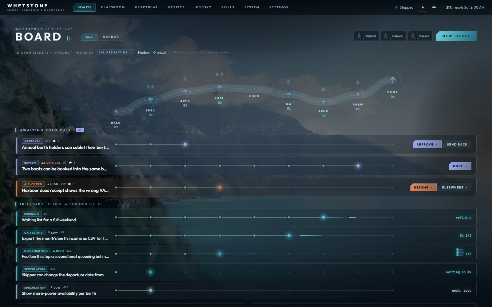

# Whetstone

A local ticketing board that runs a small fleet of coding agents through your tickets — plan,
build, test, tidy — and stops at the points where a person should decide.



Whetstone is a single app on your own machine. You write a ticket (or link one from Jira or Azure
Boards), and a background loop called the **heartbeat** hands it to an agent, one phase at a time.
Each phase leaves a record a human can check: a plan, a diff, a QA checklist with screenshots, a
short brief on what changed. Nothing is pushed, merged or deployed without you.

> The screenshots show a fictional project, "Harbor", seeded for this README.

## What it does

**A pipeline with gates.** A ticket moves through speculation, implementation, QA and refinement.
Three of the stops belong to you: approve the plan, review the result, and answer when an agent is
blocked on a decision only you can make.

| Phase | Who | What it leaves behind |
|---|---|---|
| Speculate | agent | Work items, each marked *required*, *consequence* or *expansion* |
| Approve | **you** | A go-ahead, or the plan sent back |
| Implement | agent | A commit on the ticket's own branch and worktree, and a summary |
| QA | agent | A checklist run against the local stack, with captioned screenshots |
| Refine | agent | One squashed commit, rebased, and a brief on the part of the domain it touched |
| Review | **you** | Merged, or sent back with notes the next run must answer |



**A record of the trip.** Every phase change, comment and run is kept, so a ticket shows how it got
where it is — including the times it went backwards.



**Review where the risk is.** The pull-request dialog drafts the title and description from the
ticket and sorts the diff by what is worth reading, so a three-line change to a query is not buried
under twenty files of generated boilerplate.



**Agents that stay on this machine.** Every worker runs in its own git worktree against a local
stack. A `PreToolUse` guard denies the commands that reach beyond it — cloud CLIs, `git push`,
database clients and HTTP requests aimed off-machine — and a ticket that asks for production work
is turned into a runbook for a person instead. A project can add rules of its own on top; it can
never loosen the shared ones.

**What it costs.** Rework rate, first-pass QA, time and tokens per phase, and how much rate-limit
headroom is left.



**Also in the box**

- Up to three workers at once, with leases so two agents never rebuild the same stack.
- Claude Code, Codex or Gemini CLI as the agent, chosen per installation, with a model per phase.
- Read-only links to Jira and Azure Boards; git or TFVC-backed repos.
- A "Classroom" that explains a finished change from the system's side, with an optional narrated
  walkthrough voiced locally.
- Slack or ntfy notifications when the fleet needs you.
- Five themes. The look is a token system, not per-page styling.

| | |
|---|---|
|  |  |

## How it fits together

```
 Browser (React + Vite)  <-- SignalR -->  ASP.NET Core API (.NET 9)  -->  SQLite (data/dashboard.db)
                                                 |        ^
                                    starts/stops |        | MCP tools: set_phase, add_qa_items, ...     
                                                 v        |
                                  heartbeat.ps1  -->  worker.ps1  -->  agent CLI in a git worktree
                                  (one loop)          (one per ticket)   + worker-guard.ps1 on every tool call
```

- **`Api/`, `Services/`, `Models/`, `Persistence/`** — the board, the phase machine, git and tracker
  integration, metrics.
- **`Mcp/`** — the tools an agent uses to read its ticket and report back. Hand-offs are tool
  calls with checked requirements, not prose the next phase has to trust.
- **`ClientApp/`** — the React client. The built bundle is committed in `wwwroot/` so a clone runs
  without a Node step.
- **`data/`** — the orchestrator (`heartbeat.ps1`, `worker.ps1`), the dispatcher prompt, the guard,
  and `skill-templates/`, which a new project's phase instructions are scaffolded from.
- **`data/projects/<key>/`** — everything specific to one project: its skills, its config, its own
  guard rules. Gitignored here; each is its own repository. The platform names no project.
- **`Whetstone.Tests/`** — about 950 xUnit tests. The PowerShell guard and base-ref logic have
  their own test scripts beside them.

[`CLAUDE.md`](CLAUDE.md) holds the conventions that are not discoverable from the code, and
[`data/README.md`](data/README.md) describes the data folder in full.

## Running it

Requirements: Windows, the .NET 9 SDK, Windows PowerShell 5.1, git, and at least one agent CLI
signed in (`claude`, `codex` or `gemini`). Node is needed only to change the client or to voice
Classroom walkthroughs.

```bash
dotnet run --project Whetstone.csproj
```

Then open http://localhost:5338, add a project in **Settings** (a name and the path to a git
repo), write a ticket, and start the heartbeat from the header. `Start-Whetstone.bat` does the
first two steps in one double-click.

Machine-local settings and secrets go in `data/config.json` and each project's `project.json`,
both gitignored; `data/config.example.json` shows the shape.

## Tests

```bash
dotnet test Whetstone.Tests -c Release
```

```bash
powershell -NoProfile -ExecutionPolicy Bypass -File data/worker-guard.tests.ps1
```

```bash
powershell -NoProfile -ExecutionPolicy Bypass -File data/worker-base.tests.ps1
```

## Status

A personal tool in daily use, built for one developer's machine. It is published as a showcase
rather than a supported product: there is no installer, and it has only been run on Windows.
